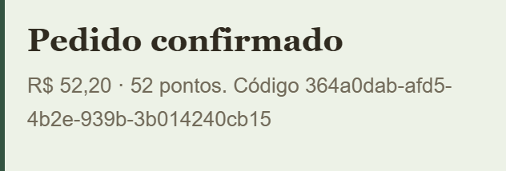
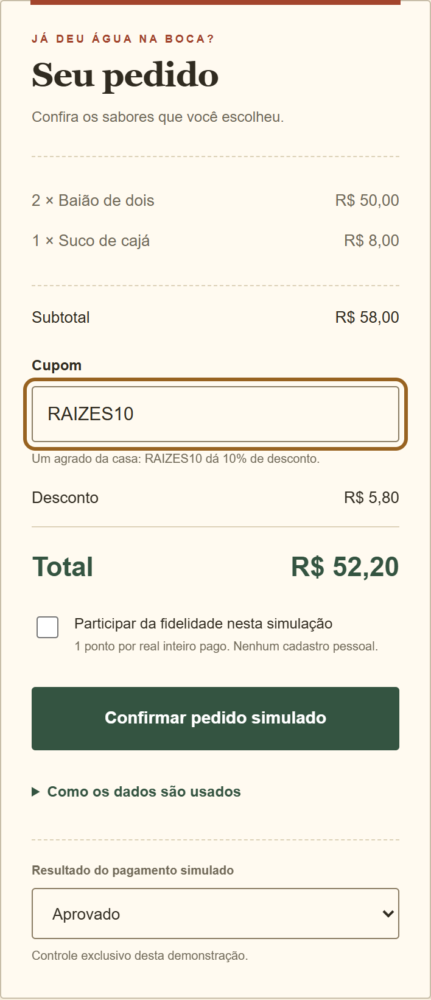
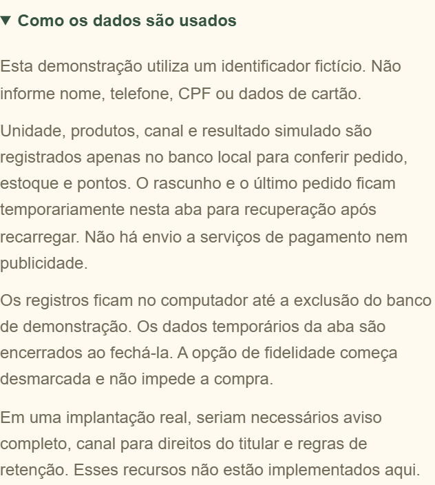

# CAPA

CENTRO UNIVERSITÁRIO INTERNACIONAL UNINTER

Análise e Desenvolvimento de Sistemas

**Diego Monteiro de Farias**

RU 4992220

**ESTRATÉGIA DE QUALIDADE PARA PEDIDOS MULTICANAL: REDE RAÍZES DO NORDESTE**

Porto, Portugal

2026

# FOLHA DE ROSTO

CENTRO UNIVERSITÁRIO INTERNACIONAL UNINTER

Análise e Desenvolvimento de Sistemas

**Diego Monteiro de Farias**

RU 4992220

**ESTRATÉGIA DE QUALIDADE PARA PEDIDOS MULTICANAL: REDE RAÍZES DO NORDESTE**

Porto, Portugal

2026

Trabalho apresentado à disciplina Projeto Multidisciplinar, Trilha de Qualidade de Software, como atividade prática de avaliação.

Professor: Me. Rodrigo Nascimento.

# RESUMO

A confirmação de uma compra precisa corresponder ao valor pago, ao estoque disponível e aos pontos de fidelidade concedidos. Este trabalho examina essa relação no fluxo de finalização de pedidos da rede fictícia Raízes do Nordeste, considerando os canais aplicativo, web, totem, balcão e retirada. A proposta reúne oito requisitos funcionais e oito requisitos de qualidade, com critérios de aceitação, arquitetura em camadas, análise de riscos e testes ligados às respectivas evidências. Para verificar as regras, foi utilizado um protótipo web local com banco SQLite e respostas de pagamento simuladas. Foram aprovados 72 testes automatizados: 54 em Python e 18 no navegador. Na carga de 200 pedidos, com dez tarefas de envio concorrentes, o tempo médio foi de 61,121 ms e o percentil 95 foi de 149,676 ms. As verificações confirmaram os cálculos, o isolamento de estoque entre unidades, as restrições de acesso nos casos definidos e a prevenção de efeitos duplicados quando a mesma chave é reenviada. A execução inicial revelou uma falha no fechamento de conexões SQLite, registrada como D01 e corrigida antes do reteste. Os tempos obtidos descrevem o ambiente local, sem comunicação com um provedor de pagamento. Disponibilidade mensal, satisfação, aceitação de negócio, aparelhos físicos e estresse prolongado ainda precisam de avaliação. O protótipo permite demonstrar as regras e repetir os testes. Sua aplicação comercial depende dessas validações e das integrações previstas.

**Palavras-chave:** qualidade de software; pedidos; rastreabilidade; testes; franquias.

# ABSTRACT

An order confirmation should match the amount paid, the available stock, and the loyalty points awarded. This study examines that relationship during checkout in the fictional Raízes do Nordeste restaurant network, covering app, web, kiosk, counter, and pickup channels. The proposal defines eight functional and eight quality requirements, with acceptance criteria, a layered architecture, risk analysis, and tests linked to their evidence. A local web prototype with a SQLite database and simulated payment responses was used to check the rules. All 72 automated tests passed: 54 in Python and 18 in the browser. A workload of 200 orders, sent by ten concurrent workers, produced an average response time of 61.121 ms and a 95th percentile of 149.676 ms. The checks confirmed calculations, stock separation between locations, access restrictions in the defined cases, and prevention of duplicate effects when the same request key is reused. The initial execution revealed a SQLite connection-closing defect, recorded as D01 and corrected before retesting. The response times describe the local environment without communication with a payment provider. Monthly availability, satisfaction, business acceptance, physical devices, and sustained stress still require evaluation. The prototype supports demonstrations and repeatable testing. Commercial use depends on those assessments and the planned integrations.

**Keywords:** software quality; orders; traceability; testing; franchises.

# SUMÁRIO

- 1 INTRODUÇÃO – p. 7
  - 1.1 Objetivo geral – p. 7
  - 1.2 Objetivos específicos – p. 7
  - 1.3 Referencial adotado – p. 8
  - 1.4 Natureza das evidências – p. 8
- 2 DOCUMENTO DE REQUISITOS – p. 9
  - 2.1 Escopo e premissas – p. 9
    - 2.1.1 Funcionalidade escolhida – p. 9
    - 2.1.2 Premissas de negócio – p. 10
    - 2.1.3 Fora do escopo – p. 10
  - 2.2 Operação multicanal – p. 10
    - 2.2.1 Partes interessadas – p. 11
    - 2.2.2 Prioridades – p. 11
  - 2.3 Requisitos funcionais – p. 12
    - 2.3.1 Regras complementares – p. 13
  - 2.4 Requisitos de qualidade – p. 13
    - 2.4.1 RQ01 Desempenho no ambiente local – p. 13
    - 2.4.2 RQ02 Disponibilidade operacional – p. 13
    - 2.4.3 RQ03 Controle de acesso e minimização – p. 14
    - 2.4.4 RQ04 Uso em dispositivos móveis – p. 14
    - 2.4.5 RQ05 Consistência e confiabilidade – p. 14
    - 2.4.6 RQ06 Observação do resultado – p. 15
    - 2.4.7 RQ07 Concorrência e preservação de estoque – p. 15
    - 2.4.8 RQ08 Testabilidade e manutenção – p. 15
    - 2.4.9 Justificativa das metas – p. 16
  - 2.5 Arquitetura e pontos de teste – p. 16
    - 2.5.1 Decisões e consequências – p. 17
  - 2.6 Caso de uso e estados do pedido – p. 18
    - 2.6.1 UC01 Finalizar pedido – p. 18
- 3 PLANO DE QUALIDADE – p. 20
  - 3.1 Processo e responsabilidades – p. 20
    - 3.1.1 Processo – p. 20
    - 3.1.2 Cronograma proposto para revisão e validação – p. 21
  - 3.2 Análise de riscos – p. 22
    - 3.2.1 Tratamento de defeitos – p. 23
  - 3.3 Privacidade e proteção de dados – p. 23
    - 3.3.1 Controles implementados e pendentes – p. 24
- 4 PLANO DE TESTES – p. 25
  - 4.1 Estratégia e ambiente – p. 25
    - 4.1.1 Ambiente e dados – p. 26
  - 4.2 Cenários de sistema – p. 26
    - 4.2.1 TS01 Pedido nos cinco canais – p. 26
    - 4.2.2 TS02 Pagamento recusado – p. 26
    - 4.2.3 TS03 Pagamento sem resposta – p. 27
    - 4.2.4 TS04 Repetição do pedido confirmado – p. 27
    - 4.2.5 TS05 Reutilização indevida da chave – p. 27
    - 4.2.6 TS06 Estoque insuficiente – p. 27
    - 4.2.7 TS07 Isolamento entre unidades – p. 28
    - 4.2.8 TS08 Fidelidade não selecionada – p. 28
    - 4.2.9 TS09 Cupom desconhecido – p. 28
    - 4.2.10 TS10 Quantidade zero – p. 28
    - 4.2.11 TS11 Carrinho vazio – p. 28
    - 4.2.12 TS12 Unidade ou canal inválido – p. 29
    - 4.2.13 TS13 Produto indevido – p. 29
    - 4.2.14 TS14 Persistência e repetição – p. 29
    - 4.2.15 TS15 Fidelidade entre unidades – p. 29
    - 4.2.16 TS16 Resposta inesperada da integração – p. 29
    - 4.2.17 TS17 Eventos e TS18 pedido inexistente – p. 30
    - 4.2.18 PR01 a PR12 Resolução de pendências – p. 30
  - 4.3 Validações complementares e humanas – p. 31
    - 4.3.1 Concorrência e segurança – p. 31
    - 4.3.2 UAT01 Protocolo de aceitação e usabilidade – p. 32
    - 4.3.3 Estresse e recuperação – p. 32
    - 4.3.4 Recuperação e conclusão pela interface – p. 33
- 5 PLANILHA DE MÉTRICAS – p. 34
  - 5.1 Coleta e responsabilidade – p. 34
- 6 RELATÓRIO FINAL DE CONFORMIDADE – p. 35
  - 6.1 Matriz de rastreabilidade – p. 35
    - 6.1.1 Cobertura funcional utilizada no indicador – p. 36
  - 6.2 Resultados e parecer – p. 36
    - 6.2.1 Execução final – p. 37
    - 6.2.2 Defeito D01 e regressão – p. 37
    - 6.2.3 Correções de execução – p. 38
    - 6.2.4 Parecer – p. 38
  - 6.3 Evidências da interface em computador – p. 39
  - 6.4 Evidências da interface móvel e privacidade – p. 40
  - 6.5 Catálogo e reprodução das evidências – p. 41
    - 6.5.1 Reprodução local – p. 42
- 7 CONCLUSÃO – p. 43
- REFERÊNCIAS – p. 44

# 1 INTRODUÇÃO

Ao comprar dois baiões e um suco, o cliente espera conferir o valor, receber a confirmação e retirar os produtos na unidade escolhida. Para concluir essa compra, o sistema precisa aplicar o desconto, verificar o estoque, interpretar o pagamento e, quando solicitado, conceder pontos. Essas etapas dependem umas das outras: uma falha de comunicação ou um segundo clique não pode gerar outra compra nem alterar os saldos novamente.

O projeto analisa esse fluxo na rede fictícia Raízes do Nordeste, com atenção às situações em que a compra não segue o caminho esperado. Entre elas estão o esgotamento do estoque durante o pedido, a falta de resposta do pagamento e o reenvio de uma solicitação. Cada situação foi traduzida em requisitos e testes, acompanhados dos registros necessários para conferir o resultado.

O trabalho reúne os cinco componentes solicitados no roteiro da disciplina Projeto Multidisciplinar, Trilha de Qualidade de Software: Documento de Requisitos, Plano de Qualidade, Plano de Testes, Planilha de Métricas e Relatório Final de Conformidade (Nascimento, 2026). As relações entre esses componentes permitem acompanhar cada regra desde sua definição até o resultado do teste correspondente.

## 1.1 Objetivo geral

Definir e avaliar uma estratégia de qualidade para a finalização de pedidos nos cinco canais da rede, com foco na consistência entre valores, pagamento, estoque e fidelidade, e identificar as condições necessárias para uma implantação real.

## 1.2 Objetivos específicos

- Definir oito requisitos funcionais e oito requisitos de qualidade aplicados à funcionalidade escolhida.
- Descrever arquitetura, responsabilidades, falhas relevantes e pontos de teste.
- Executar testes positivos, negativos, de integração, sistema, regressão, segurança e concorrência no recorte implementado.
- Planejar validações com usuários, disponibilidade e estresse progressivo.
- Vincular requisitos, cenários, resultados e evidências em uma matriz de rastreabilidade.

## 1.3 Referencial adotado

A seleção dos atributos de qualidade tomou como referência a apresentação pública do modelo ISO/IEC 25010:2023, da International Organization for Standardization (ISO). A consulta ajudou a organizar os requisitos, mas não incluiu uma auditoria da norma completa nem um processo de certificação (ISO, 2023).

Para organizar os testes e relacioná-los aos requisitos, resultados e defeitos, foi utilizado o programa Certified Tester Foundation Level (CTFL), versão 4.0.1, do International Software Testing Qualifications Board. A relação entre esses registros segue a orientação de rastreabilidade apresentada na seção 1.4.4 do programa (ISTQB, 2024). Os critérios numéricos adotados, como tempo de resposta e disponibilidade, foram definidos para este projeto e precisam ser revistos diante das condições de uma operação real.

## 1.4 Natureza das evidências

Os testes usam respostas de pagamento controladas para verificar as regras do pedido. Seus resultados descrevem o comportamento do protótipo nessas condições. O contato com uma operadora real ainda precisa ser avaliado. O Quadro 1 distingue os testes executados, os elementos simulados e as atividades planejadas.

Quadro 1 – Classificação das evidências

| Classificação | Significado neste trabalho |
|---|---|
| Executado | Código ou interface testados neste computador, com registro de resultado. |
| Simulado | Dados de negócio, identidades e respostas do pagamento são fictícios. O teste sobre eles foi realmente executado. |
| Planejado | Procedimento definido, ainda sem coleta ou participação humana. Não é contabilizado como aprovado. |

Fonte: especificação e registros de verificação do projeto (2026).

# 2 DOCUMENTO DE REQUISITOS

Este documento define as regras de finalização do pedido e os critérios usados para verificá-las. O escopo delimita o que o protótipo oferece, e os requisitos especificam o comportamento esperado. A arquitetura e o caso de uso mostram como pagamento, estoque e fidelidade se relacionam.

## 2.1 Escopo e premissas

O estudo concentra-se no fechamento da compra. Os testes utilizam um cardápio pequeno, duas unidades e respostas de pagamento controladas, de modo que seja possível repetir as entradas e conferir os saldos. As premissas a seguir definem essas condições e os limites da versão avaliada.

### 2.1.1 Funcionalidade escolhida

**Finalizar pedido com pagamento simulado e atualização consistente de estoque e fidelidade.** A escolha permite avaliar, em uma mesma compra, o cálculo dos valores, a resposta da integração, os saldos e a mensagem recebida pelo cliente. Uma tela pode mostrar o total correto e, ainda assim, ocultar um erro no banco: se o reenvio causar uma segunda baixa de estoque, a regra foi descumprida. Por isso, a verificação acompanha tanto a resposta exibida quanto os registros alterados.

O Quadro 2 apresenta os limites definidos para cada parte do recorte.

Quadro 2 – Delimitação do escopo

| Incluído | Limite adotado |
|---|---|
| Unidades e cardápio | Recife (REC) e João Pessoa (JPA), com três produtos fictícios. |
| Pedidos | Entre um e três produtos diferentes, com quantidade inteira de 1 a 10 por produto. |
| Promoção | Cupom RAIZES10 aplica 10% ao subtotal. Sem acúmulo de cupons. |
| Pagamento | Respostas controladas: aprovado, recusado e sem resposta. A pendência pode receber aprovação ou recusa simulada. Nenhuma cobrança. |
| Estoque e pontos | Estoque separado por unidade e pontos ligados a uma identidade fictícia comum às unidades. |
| Demonstração | Interface web responsiva, API local e banco SQLite. |

Fonte: especificação e registros de verificação do projeto (2026).

### 2.1.2 Premissas de negócio

O cardápio de teste tem baião a R$ 25,00, tapioca a R$ 12,00 e suco a R$ 8,00. Esses preços e a promoção foram propostos para o estudo e não representam uma empresa real. A adesão à fidelidade é opcional: cada real inteiro do total confirmado corresponde a um ponto. Cancelamentos, estornos, expiração de pontos e administração de promoções ficam para outra versão.

Os testes isolados começam com dez unidades de cada produto. A demonstração começa com cem unidades e o teste de carga, com dez mil. Cada ambiente utiliza um banco próprio. Assim, uma compra feita durante a demonstração não altera o saldo usado para conferir um teste.

### 2.1.3 Fora do escopo

O projeto não implementa o sistema completo da rede. Pagamento real, produção comercial, logística, marketing, infraestrutura física e suporte pós-implantação ficam fora do escopo. O servidor atende apenas no endereço local do computador. Este PDF reúne as telas e os resultados essenciais da avaliação. Os arquivos de execução permitem reproduzir a demonstração localmente.

## 2.2 Operação multicanal

Os cinco canais compartilham as regras do pedido, mas apresentam condições de uso distintas. Uma interrupção no celular e o encerramento de uma sessão em equipamento compartilhado, por exemplo, exigem cuidados próprios. O Quadro 3 reúne essas diferenças operacionais.

Quadro 3 – Características dos canais de atendimento

| Canal | Uso previsto | Variação que precisa ser considerada |
|---|---|---|
| APP | Cliente monta e confirma o pedido no celular. | Toque, tela pequena, interrupção da conexão e retomada. |
| WEB | Cliente utiliza navegador em computador ou celular. | Redimensionamento, teclado e atualização da página. |
| TOTEM | Cliente faz o pedido em equipamento compartilhado. | Limpeza da sessão ao final e ausência de dados do cliente anterior. |
| BALCÃO | Operador registra o pedido presencial. | Restrição à unidade de trabalho e confirmação verbal dos itens. |
| PICKUP | Cliente ou operador acompanha a retirada. | Local e código de retirada claros, com conferência pela unidade correta. |

Fonte: especificação e registros de verificação do projeto (2026).

No protótipo, o canal é registrado no pedido e todos os canais seguem as mesmas regras de negócio. O ciclo completo de retirada, a sessão de totem, o aplicativo nativo e a autenticação de operador ainda precisam ser implementados. Suas particularidades foram incluídas na especificação e no plano de aceitação para orientar essa continuidade.

### 2.2.1 Partes interessadas

O cliente precisa conferir o preço, entender o resultado do pagamento e ter suas informações protegidas. A equipe da unidade deve conseguir identificar os pedidos que lhe pertencem e verificar se há estoque para atendê-los. Para a gestão, regras uniformes e indicadores ajudam a localizar problemas entre unidades. A equipe técnica, por sua vez, depende de registros que permitam reproduzir defeitos e avaliar as correções.

### 2.2.2 Prioridades

O impacto na operação orienta a ordem de prioridade. Impedir pedidos duplicados, preservar estoque e pontos diante de falhas e limitar consultas ao ator autorizado são as primeiras necessidades. A clareza da interface, o desempenho e o acompanhamento do fluxo vêm em seguida, pois ajudam a usar e observar essas regras com segurança.

A falta de resposta do pagamento merece atenção: em uma operação real, ela deixa o resultado da cobrança incerto. Na demonstração, o pedido permanece pendente até que seja escolhida uma aprovação ou recusa simulada. Essa escolha permite acompanhar a mudança de estado e seus efeitos, sem cobrança. A consulta automática a um provedor real e a conciliação comercial permanecem previstas para outra etapa.

## 2.3 Requisitos funcionais

Os oito requisitos funcionais têm prioridade alta porque participam diretamente da finalização do pedido. As regras de negócio foram definidas para este estudo, já que o roteiro não apresenta um catálogo operacional completo. O Quadro 4 relaciona cada requisito a um critério de aceitação que pode ser conferido no protótipo.

Quadro 4 – Requisitos funcionais e critérios de aceitação

| ID | Comportamento e critério de aceitação |
|---|---|
| RF01 | Selecionar unidade e canal. Aceitar apenas REC/JPA e os cinco canais previstos. Valores desconhecidos são rejeitados antes da gravação. |
| RF02 | Validar o carrinho. Exigir de 1 a 3 produtos distintos, conhecidos, com quantidade inteira de 1 a 10. Carrinho vazio, produto repetido ou quantidade inválida não cria pedido. |
| RF03 | Calcular valores no serviço. Com dois baiões e um suco, o subtotal é de R$ 58,00. O cupom RAIZES10 concede desconto de R$ 5,80, resultando no total de R$ 52,20. Cupom desconhecido é rejeitado. |
| RF04 | Registrar resultado simulado. A aprovação produz CONFIRMADO, a recusa produz RECUSADO e a ausência de resposta produz PENDENTE. A pendência pode ser aprovada ou recusada pelo simulador, com nova conferência do estoque antes de confirmar. O usuário recebe mensagem correspondente. |
| RF05 | Atualizar estoque somente na confirmação. Recusa, pendência ou erro não reduzem o estoque. A compra em uma unidade preserva o saldo da outra. |
| RF06 | Creditar fidelidade opcional uma única vez. Total de R$ 52,20 concede 52 pontos quando confirmado e com fidelidade selecionada. Nos demais casos, zero pontos. |
| RF07 | Impedir pedido duplicado. Mesma identidade, unidade, chave e conteúdo recuperam o pedido original. Chave reutilizada com conteúdo diferente retorna conflito. A interface conserva a solicitação durante a recarga da mesma aba para permitir sua repetição sem nova compra. |
| RF08 | Consultar pedido com autorização. O cliente consulta o próprio pedido, e o operador consulta apenas a sua unidade. Outros acessos são negados. A API de demonstração expõe somente o cliente fictício. |

Fonte: especificação e registros de verificação do projeto (2026).

### 2.3.1 Regras complementares

Os valores são armazenados em centavos inteiros, e o desconto é arredondado ao centavo mais próximo. A chave que controla os reenvios aceita de 8 a 80 caracteres alfanuméricos, hífen ou sublinhado. O serviço associa essa chave ao cliente e à unidade, de modo que o mesmo valor de chave, usado em contextos distintos, não confunda os pedidos.

## 2.4 Requisitos de qualidade

O serviço de pedidos precisa responder em tempo aceitável, preservar os dados e permitir que suas regras sejam verificadas. Os requisitos de qualidade estabelecem metas, métodos de medição e critérios de aceitação para essas necessidades. Também indicam o alcance dos resultados disponíveis e as avaliações que ainda dependem de coleta.

### 2.4.1 RQ01 Desempenho no ambiente local

A resposta do serviço é avaliada com 200 pedidos via HTTP local, dez threads (linhas de execução) e cinco aquecimentos anteriores à coleta. **Meta:** média e p95 inferiores a 2.000 ms. **Medição:** tempo entre o envio e a leitura completa da resposta. **Aceitação:** todas as respostas esperadas confirmadas e os dois limites de tempo atendidos. **Evidência:** EV02. Essas condições definem a medição local. A meta não representa um acordo de serviço de produção.

### 2.4.2 RQ02 Disponibilidade operacional

**Meta proposta:** disponibilidade mensal de pelo menos 99,5%, com manutenção planejada incluída no denominador. A medição exige um monitor externo que verifique a saúde do serviço uma vez por minuto. **Aceitação:** dividir as verificações que confirmam o serviço disponível pelo total de verificações previstas no mês. O resultado deve atingir a meta. As lacunas de monitoramento permanecem no denominador e devem ser relatadas. **Situação:** não medido, pois ainda não há uma implantação observada durante um mês. **Evidência prevista:** EV06.

### 2.4.3 RQ03 Controle de acesso e minimização

**Meta:** negar 100% das consultas indevidas da suíte definida e rejeitar 100% dos pedidos com campos pessoais não previstos. Os casos SE01, SE02, API02 e API04 verificam esse comportamento, com respostas 403, 401 ou 422, conforme a situação. **Aceitação:** nenhuma divulgação do pedido indevido e nenhuma criação de pedido com campos proibidos. **Evidência:** EV01. A verificação utiliza uma sessão local de demonstração. A autenticação comercial ainda precisa ser desenvolvida.

### 2.4.4 RQ04 Uso em dispositivos móveis

A avaliação considera o espaço disponível na tela e a realização da tarefa por pessoas. **Meta de interface:** ausência de rolagem horizontal em larguras de 360, 390 e 768 pixels, com controles de quantidade de ao menos 44 por 44 pixels. **Meta de uso:** pelo menos 9 de 10 participantes concluírem um pedido em até 120 segundos, sem intervenção do moderador. **Medição:** UI05 para o layout e UAT01 para o uso humano. O layout foi verificado em navegador redimensionado. A meta com participantes ainda não foi medida. **Evidências:** EV03 e EV05, respectivamente.

### 2.4.5 RQ05 Consistência e confiabilidade

**Meta:** nenhum pedido, baixa de estoque ou crédito duplicado nas repetições testadas. Também não deve haver baixa ou crédito enquanto o pedido estiver recusado ou pendente, nem quando ocorrer erro de integração. TS02 a TS07, TS15, TS16, CC01 e os cenários PR conferem os efeitos no banco. **Aceitação:** correspondência exata entre o estado esperado e os registros encontrados, inclusive após resolver uma pendência. **Evidência:** EV01. Os resultados se limitam ao banco local e ao gateway simulado.

### 2.4.6 RQ06 Observação do resultado

Os eventos registram a criação do pedido e as mudanças de estado. **Meta:** registrar um evento na criação e outro somente quando uma pendência muda efetivamente para CONFIRMADO ou RECUSADO. Repetições da criação ou da decisão não acrescentam eventos. O registro deve conter apenas sequência, código do pedido, unidade, estado e instante. **Medição:** TS04, TS17 e cenários PR de resolução. **Aceitação:** contagem e conjunto de campos iguais aos especificados. **Evidência:** EV01. Em produção, identificadores vinculáveis a pessoas podem ser dados pessoais. Retirar o nome, por si só, não comprova anonimização.

### 2.4.7 RQ07 Concorrência e preservação de estoque

A disputa pelo mesmo estoque precisa produzir um resultado previsível. **Meta:** entre cinquenta pedidos executados por vinte threads para dez unidades disponíveis, confirmar exatamente dez e rejeitar quarenta por falta de estoque, sem saldo negativo. Em cinquenta repetições de uma mesma chave, deve ser criado exatamente um pedido. **Medição:** CC01 e CC02. **Aceitação:** contagens exatas e zero erro técnico inesperado. **Evidência:** EV01. O ensaio verifica esse volume de concorrência. A escalabilidade horizontal permanece proposta.

### 2.4.8 RQ08 Testabilidade e manutenção

**Meta:** associar ao menos um cenário automatizado a cada um dos oito RF e permitir que a suíte seja repetida com banco novo, sem depender de serviço externo. A medição divide os oito RF cobertos pelos oito RF especificados e apresenta o mapeamento dos casos. **Aceitação:** cobertura funcional de 100% e execução bem-sucedida na versão identificada. **Evidências:** EV01, EV03 e EV04. O indicador verifica a presença de testes por requisito, sem medir linhas, ramos ou todas as combinações de regras.

### 2.4.9 Justificativa das metas

Um único pedido duplicado ou um saldo negativo já descumpre as regras de consistência. Por isso, essas metas adotam tolerância zero. Os limites de tempo e disponibilidade são referências iniciais baseadas nos exemplos do roteiro. Antes de aplicá-los a uma operação real, será necessário revê-los conforme a carga e a infraestrutura disponíveis. Os resultados medidos e as metas ainda não avaliadas são identificados separadamente no relatório.

## 2.5 Arquitetura e pontos de teste

A arquitetura distribui a apresentação do pedido, a comunicação com a API, as regras de negócio e o acesso ao banco entre componentes com responsabilidades definidas. Essa divisão ajuda a localizar uma falha e a escolher o nível de teste adequado. A Figura 1 apresenta as dependências entre os componentes implementados.

Figura 1 – Arquitetura do protótipo local

Interface → API → Aplicação → Domínio. Aplicação → SQLite e PaymentMock.

Fonte: código do protótipo e documentação do projeto (2026).

O Quadro 5 relaciona cada camada às responsabilidades e aos testes correspondentes.

Quadro 5 – Responsabilidades das camadas do protótipo

| Camada | Responsabilidade e verificação |
|---|---|
| Interface | index.html apresenta cardápio, resumo e estados, preserva a sessão da aba e permite concluir uma pendência simulada. Os cenários UI verificam interação, mensagens, privacidade, layout e recuperação de falhas. |
| API | api.py recebe JSON, verifica sessão, limita o tamanho e traduz erros. API01 a API08 verificam criação, consulta, resolução simulada e tratamento de falhas locais. |
| Aplicação | service.py coordena pedido, estoque, pontos, repetição, resolução simulada e consulta autorizada. TS, SE e PR verificam os fluxos. |
| Domínio | domain.py valida entradas e calcula valores. TU01 a TU06 verificam limites e regras. |
| Infraestrutura | repository.py cria e acessa o SQLite. PaymentMock fornece resultados controlados. CC e TS16 verificam concorrência e falhas. |

Fonte: especificação e registros de verificação do projeto (2026).

### 2.5.1 Decisões e consequências

**Banco local e transação única:** o SQLite facilita a execução da demonstração e reúne as alterações do pedido em uma transação. Essa escolha ajuda a preservar a consistência, mas serializa as escritas e limita a capacidade. Uma expansão exige reavaliar esse comportamento.

**Gateway substituível:** o componente simulado permite provocar aprovação, recusa e pendência de forma controlada, sem conta comercial ou cobrança. Com isso, os testes podem verificar a reação do serviço a cada resposta. Latência, disponibilidade e segurança de um provedor real continuam fora dessa verificação.

**Repetição por chave:** o serviço recupera o pedido original quando recebe a mesma chave e o mesmo conteúdo. A interface guarda o carrinho, o resultado e a solicitação ainda sem resposta no armazenamento da sessão da aba. Assim, recarregar a página no mesmo endereço permite retomar a compra. Essa proteção depende da disponibilidade do armazenamento do navegador. Fechar a aba, limpar seus dados ou mudar a porta pode encerrar a recuperação. Uma compra iniciada com outra chave continua sendo uma nova solicitação.

**Pendência simulada:** a aprovação ou recusa é escolhida explicitamente na interface. Antes de confirmar, o serviço volta a conferir o estoque e aplica a baixa e os pontos na mesma transação. A falta de estoque preserva o pedido pendente, permitindo uma recusa posterior. Repetir a decisão concluída recupera o resultado, enquanto uma decisão oposta é rejeitada. O comportamento demonstra a transição local e não substitui a conciliação com uma operadora.

**Arquitetura futura:** a proposta é utilizar uma API sem estado compartilhada entre canais, banco transacional e integração com confirmação idempotente. A reserva de estoque e a conciliação precisam considerar que o pagamento externo pode falhar em um momento diferente da gravação local. A transação SQLite, sozinha, não garante atomicidade entre o banco e um gateway real.

## 2.6 Caso de uso e estados do pedido

O caso de uso UC01 acompanha a compra desde a seleção dos itens até a mensagem apresentada ao cliente. Ele também define em que momento o estoque e os pontos podem mudar, conforme a resposta do pagamento.

### 2.6.1 UC01 Finalizar pedido

**Ator principal:** cliente. **Atores de apoio:** operador da unidade e serviço de pagamento simulado. **Pré-condições:** unidade válida, catálogo carregado e sessão local disponível. **Pós-condição de sucesso:** um pedido confirmado, estoque atualizado e pontos opcionais creditados uma vez.

1. O cliente seleciona unidade e canal e inclui os produtos.
2. A interface apresenta subtotal, desconto e total para conferência.
3. Ao confirmar, o cliente envia o pedido com uma chave de repetição.
4. O serviço valida os dados e verifica se a chave já foi utilizada.
5. Para pedido novo, confere estoque e calcula o valor no servidor.
6. O gateway simulado produz um resultado.
7. A aplicação grava pedido e evento. Estoque e pontos mudam somente quando o estado é CONFIRMADO.
8. A interface apresenta confirmação, recusa ou pendência.
9. Se houver pendência, o cliente pode escolher uma aprovação ou recusa simulada. A confirmação exige estoque disponível. A recusa preserva estoque e pontos.

O Quadro 6 especifica as respostas esperadas para as condições do pedido.

Quadro 6 – Condições e resultados do pedido

| Condição | Resultado esperado |
|---|---|
| Dados inválidos | Erro específico, sem pedido gravado. |
| Estoque insuficiente | SEM_ESTOQUE, HTTP 409, sem alteração parcial. |
| Mesma chave e mesmo conteúdo | Retorno do pedido original, HTTP 200, sem nova operação. |
| Mesma chave e conteúdo diferente | CHAVE_REUTILIZADA, HTTP 409. |
| Pagamento aprovado | CONFIRMADO, com HTTP 201 para pedido novo. |
| Pagamento recusado | RECUSADO, sem baixa ou pontos. Não há cobrança. |
| Pagamento sem resposta | PENDENTE, sem baixa ou pontos. Aprovação ou recusa simulada disponível. |
| Aprovação de pendência | CONFIRMADO após nova conferência de estoque, com baixa e pontos uma única vez. |
| Aprovação de pendência sem estoque | SEM_ESTOQUE, HTTP 409. O pedido permanece PENDENTE, sem alterações parciais. |
| Recusa de pendência | RECUSADO, sem baixa ou pontos. |
| Decisão já concluída | A mesma decisão recupera o resultado. Uma decisão oposta retorna HTTP 409. |

Fonte: especificação e registros de verificação do projeto (2026).

A resolução da pendência mantém o código do pedido e acrescenta um evento de mudança de estado. Repetir a decisão recupera esse resultado, sem nova baixa, crédito de pontos ou evento. Em um sistema real, a decisão dependeria de uma resposta verificável do provedor de pagamento. O reenvio da solicitação, por si só, não deve iniciar outra cobrança.

# 3 PLANO DE QUALIDADE

O plano de qualidade define como revisar os requisitos, distribuir as responsabilidades, tratar os riscos e avaliar os controles de privacidade. Essas atividades orientam a decisão de aceitar a versão demonstrativa. A aceitação de negócio e as demais avaliações que dependem de participantes continuam planejadas.

## 3.1 Processo e responsabilidades

Alterações que afetem o comportamento do pedido exigem nova avaliação. Os critérios de entrada e saída definem as condições para iniciar os testes e encerrar a verificação local. Os papéis previstos indicam quem deverá acompanhar cada atividade.

### 3.1.1 Processo

A revisão começa pela definição do comportamento esperado. Em seguida, os riscos orientam a escolha dos cenários, mantendo a ligação entre requisito, teste e evidência a cada alteração. Uma falha deve ser registrada, investigada, corrigida e testada novamente. A decisão de liberar a versão também precisa considerar os riscos que os controles atuais ainda não tratam.

**Entrada nos testes:** os requisitos devem estar identificados, os dados fictícios disponíveis, a versão do código registrada e o banco isolado, sem pagamento real. **Saída do recorte demonstrativo:** todos os testes automatizados aprovados, evidências legíveis, requisitos pendentes identificados e nenhum defeito crítico conhecido em aberto no fluxo local. O atendimento dessas condições permite encerrar a avaliação da demonstração, sem autorizar a operação em produção. A organização dos critérios, dos retestes e dos registros de defeitos toma como referência o CTFL. As condições concretas foram definidas para este protótipo (ISTQB, 2024, seções 2.2.3, 5.1.3 e 5.5).

O Quadro 7 distribui as responsabilidades previstas. QA, sigla de Quality Assurance, identifica o papel de garantia da qualidade. Os representantes de negócio ainda precisam participar da validação.

Quadro 7 – Papéis e responsabilidades previstos

| Papel previsto | Responsabilidade |
|---|---|
| Responsável pelo projeto | Revisar requisitos, acompanhar validações e registrar alterações. |
| QA | Elaborar cenários, coletar evidências e avaliar conformidade. |
| Desenvolvimento | Implementar regras, corrigir defeitos e manter os testes. |
| Representante da franquia | Validar regras operacionais e conduzir aceite de negócio. Participação ainda não realizada. |
| Responsável por privacidade | Revisar tratamentos, bases legais e procedimentos de atendimento. Papel previsto, não designado. |

Fonte: planejamento do projeto (2026).

### 3.1.2 Cronograma proposto para revisão e validação

O cronograma do Quadro 8 distribui a revisão e as validações previstas em quatro etapas, com uma saída definida para cada uma.

Quadro 8 – Cronograma proposto de validação

| Etapa | Atividade | Saída |
|---|---|---|
| Semana 1 | Estudo do roteiro, revisão de premissas e requisitos. | Escopo e critérios revisados. |
| Semana 2 | Revisão da arquitetura e repetição dos testes. | Evidências próprias e registro de problemas. |
| Semana 3 | UAT, usabilidade, dispositivos e estresse. | Dados humanos e limites de capacidade. |
| Semana 4 | Análise das métricas, revisão textual e da entrega. | Relatório revisado e pendências resolvidas. |

Fonte: planejamento do projeto (2026).

As quatro semanas indicam uma sequência proposta para organizar as próximas validações. O histórico efetivo das execuções deve ser consultado nas datas dos registros de evidências.

## 3.2 Análise de riscos

A análise combina probabilidade e impacto para ordenar os riscos, conforme a abordagem apresentada no CTFL (ISTQB, 2024, seção 5.2). Neste projeto, foram propostas notas de 1 (baixo) a 3 (alto) para cada fator. A multiplicação dessas notas define a prioridade inicial. A escala e as avaliações não resultam de uma medição estatística de frequência. O responsável pelo negócio ainda deverá revisar os riscos que permanecem após os controles.

O Quadro 9 relaciona os riscos prioritários, os controles e as ações residuais.

Quadro 9 – Riscos, controles e ações residuais

| Risco e prioridade | Prevenção e evidência | Limitação ou ação residual |
|---|---|---|
| RS01 Pedido duplicado. P3 × I3 = 9. | Comparação de chave e conteúdo, com a solicitação preservada na sessão da aba. TS04, TS05, CC01 e recuperação na interface. | Fechar a aba, limpar o armazenamento ou mudar a porta pode encerrar a retomada. Uma chave nova identifica outra compra. |
| RS02 Estoque negativo. P3 × I3 = 9. | Transação e verificação antes da baixa. TS06 e CC02. | Concorrência distribuída e reserva com pagamento externo ainda não validadas. |
| RS03 Pagamento incerto. P2 × I3 = 6. | Estado PENDENTE sem baixa ou pontos. Resolução simulada com nova validação de estoque. TS03, UI04 e PR. | Implementar consulta ao provedor, reserva e conciliação automática antes de produção. |
| RS04 Acesso cruzado. P2 × I3 = 6. | Regra por identidade/unidade. SE01, SE02 e API02. | Autenticação comercial, papéis e ciclo de sessão pendentes. |
| RS05 Lentidão em pico. P3 × I2 = 6. | Medição local e teste de concorrência. EV02. | SQLite serializa escrita. Executar estresse e dimensionar banco/serviço. |
| RS06 Exposição de dados. P2 × I3 = 6. | Dados fictícios, campos permitidos e eventos mínimos. TU06, API04, TS17. | Definir retenção, direitos, criptografia e responsáveis na implantação. |
| RS07 Evidência inacessível. P2 × I2 = 4. | Capturas e resultados incorporados ao PDF. | Conferir a legibilidade do PDF e o acesso às referências externas citadas. |

Fonte: planejamento do projeto (2026).

### 3.2.1 Tratamento de defeitos

O registro de defeito deve permitir que outra pessoa reproduza o problema. Ele precisa conter identificador, versão, passos, resultado esperado, resultado observado, evidência, gravidade e situação. Cobrança indevida, perda de pedido ou exposição de dados caracterizam defeitos críticos e impedem a liberação. Depois da correção, o cenário afetado e os testes de regressão pertinentes devem ser executados novamente. A investigação deve conferir se diferentes erros de execução têm a mesma causa antes de contá-los como defeitos independentes.

## 3.3 Privacidade e proteção de dados

A demonstração utiliza apenas identidades e dados fictícios de negócio. O aviso da interface explica a finalidade do uso, o armazenamento local e a ausência de cobrança. Nome, telefone, CPF e cartão não são solicitados, e o serviço rejeita campos que não estejam previstos. A fidelidade começa desmarcada para que sua seleção seja opcional.

Para uma implantação real, a Lei Geral de Proteção de Dados Pessoais (LGPD) exige analisar finalidade, necessidade e transparência. Consentimento é uma das hipóteses legais e não deve ser usado como autorização genérica para todo tratamento. A execução do pedido pode envolver a hipótese contratual, sujeita à análise do contexto. Também são previstos direitos como acesso e correção (Brasil, 2018, arts. 6, 7, 8, 9 e 18).

O Quadro 10 reúne as decisões propostas para os tratamentos de dados.

Quadro 10 – Tratamentos de dados e decisões propostas

| Tratamento previsto | Decisão proposta e situação |
|---|---|
| Pedido e retirada | Coletar somente dados necessários à compra e identificação da retirada. No protótipo, usar código fictício. |
| Fidelidade | Participação opcional e informação clara sobre a regra. Em produção, definir cadastro, finalidade e hipótese legal específica. |
| Marketing | Não implementado nem vinculado à compra. Se adotado com consentimento, solicitar autorização separada, específica e revogável. |
| Eventos técnicos | Registrar código do pedido, unidade, estado e instante. Restringir acesso e revisar prazo de retenção. |
| Direitos do titular | Planejar canal de solicitação, verificação de identidade, registro e atendimento. Não implementado. |
| Retenção | Na demonstração, os pedidos permanecem no banco local até sua exclusão. O navegador conserva a compra na sessão da aba para retomada. Em produção, definir prazos conforme a finalidade e as obrigações aplicáveis. |

Fonte: planejamento do projeto (2026).

### 3.3.1 Controles implementados e pendentes

Os controles implementados começam na entrada da API: verificação do token de demonstração, limite de 16 KB para o corpo e rejeição de campos extras. O acesso ao banco utiliza consultas parametrizadas. Na interface, os resultados são inseridos como texto, sem interpretar HTML enviado pelo usuário.

Permanecem pendentes HTTPS comercial, identidade real, gestão de consentimento, criptografia em repouso, eliminação automatizada e atendimento de direitos. O token fornecido pela página é restrito à demonstração no computador. O conjunto atual de controles, portanto, não permite declarar conformidade integral com a LGPD nem autoriza o tratamento de dados pessoais reais.

# 4 PLANO DE TESTES

O plano de testes cobre situações que podem comprometer a compra: valor incorreto, falta de estoque, pagamento sem resposta, repetição do envio e consulta por pessoa não autorizada. Cada cenário descreve as entradas e o resultado esperado. Seus identificadores permitem localizar os registros da execução e conferir os requisitos verificados.

## 4.1 Estratégia e ambiente

O Quadro 11 apresenta os tipos de teste e a situação de cada validação.

Quadro 11 – Tipos de teste e situação da validação

| Tipo exigido | Aplicação e situação |
|---|---|
| Unitário | TU01 a TU06: validações, valores e limites. Executado. |
| Integração | Aplicação, SQLite e PaymentMock, incluindo falha do gateway em TS16. Executado. |
| Sistema | TS01 a TS18 sobre o recorte local. Os pedidos passam por HTTP. TS14 também recria o serviço e TS18 consulta diretamente a regra. UI01 a UI04 completam o fluxo com navegador. |
| Regressão | Reexecução da suíte, RG01 a RG04 e UI07 a UI18 após as correções de execução e recuperação. Executado. |
| Aceitação UAT | Representantes de cliente e operação conferem pedido, valor, pontos e retirada. Planejado. |
| Usabilidade | Tarefa observada com dez participantes, tempo, sucesso e dificuldades. Planejado. |
| Desempenho | Carga local com 200 pedidos e dez threads. Executado. Estresse progressivo até degradação e recuperação: planejado. |
| Segurança | Isolamento de consulta, sessão local, campos extras e entradas indevidas. Executado no recorte, sem constituir auditoria completa. |
| Responsividade mobile | Google Chrome em 360, 390 e 768 px, com verificação de rolagem horizontal e controles de toque. Executado. Aparelhos físicos pendentes. |

Fonte: especificação e registros de verificação do projeto (2026).

### 4.1.1 Ambiente e dados

Os registros de 28 de setembro de 2026 foram obtidos com Python 3.14.7 em Windows AMD64, usando bibliotecas padrão, e com Google Chrome 154.0.8037.58, controlado por Playwright. O protótipo utiliza SQLite, que serializa as transações de escrita. Cada teste integrado de regras começa com um banco temporário novo. A exceção ocorre quando a própria verificação exige manter os dados entre etapas, como no teste de persistência.

O pedido padrão reúne dois baiões e um suco, cupom RAIZES10, fidelidade selecionada e unidade REC. Quando a compra é confirmada, o resultado esperado é R$ 52,20 e 52 pontos. Os cenários indicam as alterações feitas nessa entrada. Como o código de cada pedido é gerado durante a execução, a conferência verifica sua criação ou manutenção entre respostas, sem exigir um identificador previamente fixado.

## 4.2 Cenários de sistema

Os cenários TS01 a TS18 acompanham a finalização do pedido e as falhas previstas para esse fluxo. Os resultados obtidos estão registrados em EV01. A conferência considera também pedidos, estoque, pontos e eventos no banco, conforme a regra de cada caso.

### 4.2.1 TS01 Pedido nos cinco canais

**Entrada:** pedido padrão, com uma chave diferente para cada canal. **Pré-condição:** dez unidades por produto em Recife. **Passos:** enviar uma compra via HTTP para cada canal e consultar o estoque. **Esperado:** cinco pedidos CONFIRMADOS, R$ 52,20 cada, canal preservado e zero baiões restantes. **Obtido:** aprovado na execução registrada em EV01. O cenário verifica se a regra de compra se mantém nos cinco canais. O uso de cinco aplicativos distintos não foi avaliado.

### 4.2.2 TS02 Pagamento recusado

**Entrada:** pedido padrão com pagamento declined. **Passos:** confirmar e consultar estoque e pontos. **Esperado:** RECUSADO, zero pontos, dez baiões e nenhum crédito de fidelidade. **Obtido:** aprovado, EV01. O cenário verifica se a recusa preserva os saldos anteriores à tentativa. UI03 confere também a mensagem Pagamento recusado no navegador.

### 4.2.3 TS03 Pagamento sem resposta

**Entrada:** pedido padrão com pagamento timeout, enviado duas vezes com a mesma chave. **Esperado:** PENDENTE nas duas respostas, mesmo ID, estoque integralmente preservado e nenhum crédito de pontos. **Obtido:** aprovado, EV01. UI04 verifica se a interface informa a pendência e bloqueia a repetição da compra. Os controles de resolução simulada permitem concluir esse pedido. A ausência de resposta é produzida pelo simulador. O teste não envolve espera por um serviço externo real.

### 4.2.4 TS04 Repetição do pedido confirmado

**Entrada:** pedido padrão confirmado, repetido cinco vezes sem mudança de chave. **Passos:** comparar as respostas e consultar pedidos, saldo e eventos. **Esperado:** um único pedido, um evento, 52 pontos e retorno do ID original. **Obtido:** aprovado, EV01. A mesma solicitação pode chegar novamente ao serviço, mas seu reenvio deve recuperar o resultado já registrado, sem repetir os efeitos da compra.

### 4.2.5 TS05 Reutilização indevida da chave

**Entrada:** confirmar o pedido padrão e reenviar a mesma chave após remover o cupom. **Esperado:** CHAVE_REUTILIZADA, HTTP 409, e apenas o pedido original no banco. **Obtido:** aprovado, EV01. Retirar o cupom altera o valor da compra. Por isso, a chave do pedido anterior não pode autorizar essa mudança silenciosamente.

### 4.2.6 TS06 Estoque insuficiente

**Pré-condição:** dez baiões disponíveis. **Entrada:** um pedido de dez baiões e, depois, outro pedido padrão com nova chave. **Esperado:** o primeiro confirma e o segundo retorna SEM_ESTOQUE, HTTP 409. O suco do segundo pedido não sofre baixa parcial. **Obtido:** aprovado, EV01. A conferência do suco verifica se a falta de um item impede a baixa parcial dos demais produtos do pedido.

### 4.2.7 TS07 Isolamento entre unidades

**Entrada:** pedido padrão na unidade REC. **Passos:** consultar o estoque de baião nas duas unidades. **Esperado:** oito unidades em Recife e dez em João Pessoa. **Obtido:** aprovado, EV01. Embora a fidelidade acompanhe a identidade do cliente entre unidades, cada restaurante mantém seu próprio estoque.

### 4.2.8 TS08 Fidelidade não selecionada

**Entrada:** pedido padrão com loyalty igual a falso. **Esperado:** CONFIRMADO, total R$ 52,20 e zero pontos. **Obtido:** aprovado, EV01. A compra deve ser concluída mesmo que o cliente não participe da fidelidade. UI06 verifica que essa opção começa desmarcada na interface.

### 4.2.9 TS09 Cupom desconhecido

**Entrada:** pedido padrão com cupom DESCONTO999. **Esperado:** CUPOM_INVALIDO, HTTP 422, mensagem explicativa e nenhum pedido criado. **Obtido:** aprovado, EV01. UI02 complementa a verificação ao conferir a mensagem apresentada no navegador.

### 4.2.10 TS10 Quantidade zero

**Entrada:** um suco com quantidade zero. **Esperado:** QUANTIDADE_INVALIDA, HTTP 422, com mensagem de que a quantidade deve ser inteira, de 1 a 10. **Obtido:** aprovado, EV01. TU03 verifica ainda valores negativos, fracionários, texto, booleano e os limites 1 e 10.

### 4.2.11 TS11 Carrinho vazio

**Entrada:** lista de itens vazia. **Esperado:** CARRINHO_INVALIDO, HTTP 422, sem compra. **Obtido:** aprovado, EV01. Na interface, UI02 confere a validação antecipada, com a mensagem Carrinho vazio e a orientação para incluir um produto.

### 4.2.12 TS12 Unidade ou canal inválido

**Entrada:** unidade XYZ e, em outra tentativa, canal SMS. **Esperado:** UNIDADE_INVALIDA e CANAL_INVALIDO, respectivamente, com HTTP 422. **Obtido:** aprovado, EV01. Mesmo que a interface ofereça apenas opções válidas, o serviço precisa conferir os valores recebidos diretamente.

### 4.2.13 TS13 Produto indevido

**Entrada:** identificador de produto contendo texto de tentativa de injeção SQL. **Esperado:** PRODUTO_INVALIDO, HTTP 422, tabela de pedidos existente e nenhum pedido criado. **Obtido:** aprovado, EV01. O resultado comprova a rejeição dessa entrada hostil específica. A avaliação de outras técnicas de ataque exige testes adicionais.

### 4.2.14 TS14 Persistência e repetição

**Passos:** confirmar o pedido via HTTP, criar uma nova instância do serviço com o mesmo banco e reenviar o pedido. **Esperado:** mesmo ID e indicação de repetição. **Obtido:** aprovado, EV01. Esse cenário verifica se o registro persistido continua sendo reconhecido após a recriação do serviço. Queda de energia durante a gravação e restauração de backup permanecem fora dessa verificação.

### 4.2.15 TS15 Fidelidade entre unidades

**Entrada:** um pedido padrão em Recife e outro em João Pessoa, para a mesma identidade fictícia. **Esperado:** dois pedidos e saldo de 104 pontos. **Obtido:** aprovado, EV01. As chaves podem ter o mesmo valor, pois a unidade também faz parte de sua identificação. Nesse caso, as duas compras são distintas e devem contribuir para o saldo comum de fidelidade.

### 4.2.16 TS16 Resposta inesperada da integração

**Passos:** substituir o gateway simulado por um que retorne estado inválido e enviar o pedido. **Esperado:** GATEWAY_INVALIDO, HTTP 502, nenhum pedido e estoque integralmente preservado. **Obtido:** aprovado, EV01. A resposta inválida provoca uma falha controlada na integração e permite conferir se a transação é desfeita por completo.

### 4.2.17 TS17 Eventos e TS18 pedido inexistente

TS17 cria um pedido em cada estado e espera três eventos, cada um com os cinco campos definidos em RQ06. TS18 consulta diretamente a regra de aplicação com um ID inexistente e espera o erro NAO_ENCONTRADO, com código 404. **Obtido:** ambos aprovados, EV01. Os eventos registram os campos previstos para acompanhar o pedido, sem armazenar o corpo da requisição, nome ou documento pessoal.

### 4.2.18 PR01 a PR12 Resolução de pendências

PR01 aprova o pedido padrão pendente, repete a decisão e consulta o resultado. Espera-se o mesmo pedido, R$ 52,20, 52 pontos, baixa única e dois eventos: criação e confirmação. PR02 repete a recusa e exige estoque e pontos preservados. PR03 tenta inverter uma decisão já concluída e espera PAGAMENTO_JA_CONFERIDO, com código 409.

PR04 envia vinte aprovações concorrentes para a mesma pendência. Somente uma pode aplicar os efeitos. PR05 disputa aprovação e recusa simultâneas e exige um único estado final. PR06 disputa as últimas dez unidades entre dois pedidos pendentes: um confirma e o outro recebe SEM_ESTOQUE. PR07 esgota um item depois da criação da pendência e confere a ausência de baixa parcial, a manutenção do estado PENDENTE e a possibilidade de recusar depois.

PR08 impede a resolução por outro proprietário e verifica pedido inexistente. PR09 aceita apenas uma decisão prevista e rejeita campos indevidos. PR10 atualiza um banco de versão anterior preservando os registros. Uma pendência antiga sem os itens salvos pode ser recusada, mas sua aprovação é bloqueada. PR11 reinicia o serviço e confirma uma pendência de João Pessoa sem fidelidade, preservando o estoque de Recife e mantendo zero pontos.

PR12 provoca uma falha ao registrar o evento de confirmação. O pedido deve continuar pendente, com estoque e pontos inalterados. Depois de retirar a falha, uma nova tentativa deve concluir. Os resultados individuais de PR01 a PR12 são registrados em EV01. Essa sequência verifica a transição no banco local, sem representar falha ou recuperação de uma cobrança real.

## 4.3 Validações complementares e humanas

Concorrência e segurança foram verificadas no ambiente local. A aceitação por participantes e o estresse prolongado seguem os protocolos abaixo e ainda dependem de execução.

### 4.3.1 Concorrência e segurança

CC01 envia cinquenta repetições da mesma chave com vinte threads, enquanto CC02 disputa dez unidades de estoque com cinquenta chaves distintas. O primeiro caso resultou em um único pedido. No segundo, houve dez confirmações e quarenta rejeições por falta de estoque. Essas rejeições são o comportamento esperado quando o produto se esgota e não entram na contagem de falhas técnicas.

SE01 verifica a tentativa de consulta por outro cliente, e SE02, por operador de outra unidade. Os testes da API incluem ausência de sessão, JSON inválido, campos pessoais indevidos, corpo maior que 16 KB e cabeçalhos de resposta. A autorização do operador foi avaliada na camada de aplicação, pois o protótipo não possui tela de login de funcionário.

API07 verifica o contrato de resolução simulada: sessão obrigatória, acesso pelo proprietário, corpo válido e retorno HTTP 200 com indicação de repetição. API08 torna o banco ou o arquivo local indisponível durante a requisição e espera uma resposta 503 compreensível, sem detalhes internos. Ao retirar a falha, o serviço deve voltar a responder e permitir a conclusão da pendência. Os registros estão em EV01.

API09 interrompe a conexão durante a resposta, depois de o pedido ser gravado. O serviço deve encerrar o envio sem tentar uma segunda resposta. Ao repetir a solicitação com a mesma chave, o teste exige a recuperação do pedido original, sem outra baixa de estoque, crédito de pontos ou evento. API10 envia um JSON válido com menos bytes que o tamanho declarado em Content-Length. O serviço deve rejeitar esse corpo incompleto com HTTP 400 e código JSON_INVALIDO, sem criar pedido. Os dois casos integram a revisão 0.5 e estão registrados em EV01.

### 4.3.2 UAT01 Protocolo de aceitação e usabilidade

**Situação:** planejado. O protocolo prevê dez participantes adultos, com perfis de cliente e operação. Antes da tarefa, o moderador deverá explicar a finalidade da sessão e o uso de dados fictícios. Cada participante deverá selecionar a unidade, montar o pedido indicado, aplicar o cupom, conferir o total e interpretar uma confirmação ou pendência. Ainda não houve participação de funcionários reais ou de outros usuários.

O registro de cada sessão deverá conter código anônimo, canal, dispositivo, duração, sucesso sem ajuda, dificuldades e nota de satisfação de 1 a 5. A meta de uso é que pelo menos nove participantes concluam a tarefa em até 120 segundos. Para satisfação, serão divididas as respostas 4 ou 5 pelo total de respostas válidas, com meta de 85%. A amostra de dez pessoas permite uma avaliação exploratória. Seus resultados não representam toda a rede.

**Aceite de negócio:** um representante da operação deverá conferir os valores, a regra de fidelidade, o estoque por unidade e o encaminhamento da pendência. Nome, data e aprovação serão registrados somente após a participação efetiva. A retirada e a limpeza de sessão do totem precisam de um protótipo complementar para serem avaliadas.

### 4.3.3 Estresse e recuperação

O ensaio deverá ocorrer em ambiente dedicado, com etapas de 10, 20 e 50 clientes concorrentes, cada uma com cinco minutos. A coleta incluirá p95, erros técnicos, bloqueios e uso de recursos. Ao exceder os limites definidos ou saturar o ambiente, a etapa deverá ser encerrada e a carga reduzida, com cinco minutos de observação da recuperação. O procedimento ainda não foi executado. CC02 verifica uma disputa específica de estoque e não fornece a observação prolongada prevista neste ensaio.

### 4.3.4 Recuperação e conclusão pela interface

Os cenários adicionais da revisão 0.4 verificam a continuidade da compra quando a página é recarregada ou a comunicação falha. UI09 confere a recuperação do rascunho, incluindo unidade, canal, itens, cupom, fidelidade e opção de pagamento. UI10 confere a confirmação após recarga e a limpeza do carrinho ao iniciar um novo pedido. UI11 acompanha a pendência até a aprovação ou recusa simulada, com conferência de estoque e pontos. Os resultados individuais ficam em EV03.

UI12 perde a resposta de uma compra, recarrega a página e repete o mesmo conteúdo com a mesma chave. O resultado esperado é recuperar o pedido original sem duplicar seus efeitos. UI15 verifica o limite de oito segundos para uma requisição sem resposta e a repetição segura. Esse limite evita que a tela fique indefinidamente aguardando, mas não comprova que o serviço deixou de processar o pedido. Por isso, uma nova tentativa conserva a solicitação original.

UI13 provoca uma falha na carga inicial do cardápio e outra após a troca de unidade. A compra deve permanecer bloqueada até a atualização bem-sucedida, sem usar o estoque da unidade anterior. UI14 verifica os controles de quantidade nos limites zero, estoque disponível e dez unidades. Esses casos complementam a validação do serviço, pois uma restrição exibida na tela não substitui a conferência no recebimento da API.

UI16 provoca a expiração da sessão local. A tela deve oferecer sua atualização e conservar o conteúdo e a chave da tentativa para concluir a compra após a recarga, com o estoque correto. O caso trata da sessão de demonstração e não avalia autenticação de clientes reais.

UI17 recarrega a página enquanto o envio ainda está em andamento e exige a recuperação do mesmo pedido, sem duplicação. UI18 perde a resposta da resolução de uma pendência: a interface deve impedir uma decisão oposta enquanto o resultado estiver incerto e recuperar o estado registrado após a recarga. Esses cenários verificam interrupções em dois momentos diferentes da compra.

# 5 PLANILHA DE MÉTRICAS

O Quadro 12 reúne os seis indicadores, suas definições, metas e resultados. Disponibilidade e satisfação ainda não foram medidas e, por isso, aparecem sem valor numérico. A ausência de coleta não deve ser registrada como resultado zero.

Quadro 12 – Indicadores, metas e resultados

| Indicador | Definição e resultado | Meta e decisão |
|---|---|---|
| Taxa de defeitos | Defeitos conhecidos em aberto / versões avaliadas: 0/1 na revisão 0.5. D01 e correções de execução concluídos. | Zero defeito crítico aberto para demonstração. Contagem não prova ausência de defeitos desconhecidos. |
| Cobertura de testes | RF com ao menos um cenário automatizado / RF do recorte: 8/8 = 100%. | 100% dos oito RF. Ampliar critérios quando o escopo crescer. Não é cobertura de código. |
| Tempo de resposta | Média: 61,121 ms. p95: 149,676 ms. 200 pedidos locais. | Média e p95 abaixo de 2.000 ms. Atende nesta execução local. |
| Disponibilidade | Verificações com serviço disponível / verificações previstas no mês. Não medido. | Pelo menos 99,5%. Implantar monitoramento externo antes da avaliação. |
| Satisfação | Respostas 4 ou 5 / respostas válidas, escala de 1 a 5. Não medido. | Pelo menos 85%. Aplicar pesquisa após a tarefa de UAT. |
| Tempo médio de correção | 0,335 hora entre falha e fechamento original de D01, n=1. Proxy local. | Até 24 h como meta proposta. Não representa histórico operacional. |

Fonte: especificação e registros de verificação do projeto (2026).

## 5.1 Coleta e responsabilidade

A cada versão, a equipe de qualidade deverá reunir os resultados dos testes e os registros de defeitos. A equipe de desenvolvimento analisará a latência após mudanças relevantes, e a operação acompanhará a disponibilidade continuamente, com revisão semanal. O responsável pela UAT coletará a satisfação após cada sessão. Para toda meta não atendida, deverá ser definida uma ação com responsável e prazo.

Pelo método do posto mais próximo, o p95 corresponde ao 190º valor dos 200 tempos ordenados. A média usa todas as amostras válidas. As cinco requisições de aquecimento ficam fora da coleta. Na disponibilidade, intervalos sem coleta não contam como serviço disponível.

# 6 RELATÓRIO FINAL DE CONFORMIDADE

A avaliação final compara os requisitos com os resultados dos testes. A matriz permite localizar as evidências. As seções seguintes apresentam os resultados, a correção do defeito D01 e as telas registradas durante a verificação da aplicação.

## 6.1 Matriz de rastreabilidade

A matriz do Quadro 13 permite localizar a evidência de cada requisito de qualidade. Quando a avaliação depende de participantes ou de monitoramento prolongado, a linha registra essa pendência.

Quadro 13 – Rastreabilidade dos requisitos de qualidade

| Requisito | Testes e evidências | Conclusão delimitada |
|---|---|---|
| RQ01 Desempenho | Carga de 200 pedidos (EV02). | Atendido na condição local definida. |
| RQ02 Disponibilidade | Monitoramento mensal (EV06 prevista). | Não medido. |
| RQ03 Segurança | SE01, SE02, API02, API04 (EV01). | Casos definidos aprovados. Autenticação real pendente. |
| RQ04 Usabilidade | UI05, UI06 (EV03). UAT01 (EV05 prevista). | Layout verificado. Uso humano não medido. |
| RQ05 Confiabilidade | TS02 a TS07, TS15, TS16, CC01, API09, API10, PR01 a PR12 (EV01). UI09 a UI12, UI15 a UI18 (EV03). | Consistência local, rejeição de corpo incompleto, resolução simulada e retomada na mesma aba. |
| RQ06 Observação | TS04, TS17, PR01 a PR07, PR12 (EV01). | Um evento de criação e um por transição efetiva, sem duplicação nos reenvios. |
| RQ07 Concorrência | CC01 e CC02 (EV01). | Atendido com 50 tentativas e 20 threads. |
| RQ08 Testabilidade | TU, TS, API e UI (EV01, EV03, EV04). | Oito RF com casos automatizados, sem medição de linhas. |

Fonte: especificação e registros de verificação do projeto (2026).

### 6.1.1 Cobertura funcional utilizada no indicador

O cálculo de cobertura considera a presença de pelo menos um cenário automatizado para cada requisito funcional. O Quadro 14 mostra quais casos sustentam essa contagem.

Quadro 14 – Cobertura dos requisitos funcionais

| RF | Casos que demonstram sua cobertura |
|---|---|
| RF01 | TS01, TS07, TS12, API06. |
| RF02 | TU03, TU04, TS06, TS10, TS11, TS13. |
| RF03 | TU01, TU02, TS09, UI01, UI02. |
| RF04 | TS02, TS03, TS16, PR01 a PR03, PR05, PR07, PR09 a PR11, UI01, UI03, UI04, UI11. |
| RF05 | TS02, TS03, TS06, TS07, CC02, PR01, PR02, PR04 a PR07, PR11, PR12, UI11, UI14. |
| RF06 | TU01, TU02, TS04, TS08, TS15, PR01, PR02, PR04 a PR07, PR11, PR12, UI11. |
| RF07 | TS03, TS04, TS05, TS14, CC01, API01, API09, PR01 a PR05, UI09, UI10, UI12, UI15 a UI18. |
| RF08 | SE01, SE02, TS18, API01, API02, API07, PR08. |

Fonte: especificação e registros de verificação do projeto (2026).

Há casos automatizados associados aos oito requisitos funcionais. Entre os requisitos de qualidade, duas avaliações ainda dependem de coleta: o protocolo com usuários, identificado por EV05, e o monitoramento de disponibilidade, identificado por EV06. Seus identificadores permitem localizar o planejamento, mas ainda não correspondem a resultados de execução.

## 6.2 Resultados e parecer

O parecer considera os resultados dos testes, o comportamento sob carga e o tratamento das falhas encontradas. A análise se limita à versão e às condições registradas nas evidências.

### 6.2.1 Execução final

A verificação da revisão 0.5, de 28 de setembro de 2026, terminou com **54/54 testes em Python e 18/18 cenários no navegador aprovados**. A suíte Python reúne testes unitários, de sistema, segurança, concorrência, API, regressão e resolução de pendências. EV01 registra os identificadores e os resultados individuais. Na contagem, cada método corresponde a um teste, mesmo quando avalia várias entradas. As combinações de dados de um mesmo método, portanto, não são contabilizadas como aprovações separadas.

Durante a carga, foram confirmados 200 de 200 pedidos. O maior tempo de resposta foi de 1108,249 ms. A vazão média foi de 151,27 pedidos por segundo em uma janela de 1,322 segundos. A base estava nova e o pagamento era simulado, sem latência externa. Por isso, os valores servem para comparar execuções locais nas mesmas condições. Estimar a capacidade de atendimento da rede exigiria uma carga mais longa, infraestrutura de produção e comunicação com serviços externos.

### 6.2.2 Defeito D01 e regressão

A primeira execução revelou um problema no encerramento dos testes. Ao sair do gerenciador de contexto, a transação SQLite era concluída, mas a conexão continuava aberta. No Windows, isso impedia a remoção dos arquivos dos bancos temporários. O pedido podia apresentar o resultado esperado enquanto a execução deixava uma conexão sem fechamento.

A falha gerou 26 erros de encerramento na suíte inicial de 34 testes. A investigação reuniu essas ocorrências em uma única causa, registrada como D01. A correção passou a fechar a conexão ao sair do contexto, inclusive quando ocorre uma exceção, e a execução posterior terminou sem o problema.

EV07 conserva o registro inicial e o fechamento de D01. EV01 apresenta a execução atual. O intervalo de 0,335 hora corresponde à correção original. Revisões posteriores não foram somadas a esse tempo, pois alterariam a medição histórica do defeito.

### 6.2.3 Correções de execução

As revisões de execução também passaram a verificar como o programa reage quando algo falha. RG01 exige resposta 401 para um cabeçalho de sessão não ASCII. RG02 confere se o coletor registra falhas em subtestes e na limpeza dos recursos, enquanto RG03 exige que uma carga com falha termine com indicação de erro. RG04 verifica a recusa de uma segunda instância na mesma porta.

Na interface, UI07 impede mudanças no pedido durante o envio. UI08 simula a perda da resposta e repete a solicitação com o mesmo conteúdo e a mesma chave, sem nova baixa no estoque. A revisão também corrigiu uma falha que ocultava a confirmação quando o cardápio não era atualizado após a compra. UI01 agora verifica se a confirmação permanece visível nessa situação, acompanhada de um aviso sobre o estoque. Os ajustes e suas verificações estão relacionados em EV08.

A revisão 0.4 amplia a recuperação: o rascunho, o resultado e a solicitação ainda sem resposta permanecem disponíveis após recarregar a mesma aba. O carregamento do cardápio pode ser repetido, e uma requisição sem resposta deixa de bloquear a tela após oito segundos. A conclusão simulada de pendências permite observar a confirmação ou a recusa mantendo o pedido original. Os cenários PR01 a PR12, API07, API08 e UI09 a UI18 verificam esses comportamentos e seus efeitos nos registros.

A revisão 0.5 corrigiu duas falhas nas requisições. Uma desconexão depois da gravação podia levar o servidor a tentar responder novamente com erro 503. Também era possível aceitar um corpo menor que o tamanho declarado, caso o trecho recebido ainda formasse um JSON válido. O envio agora termina quando a conexão é interrompida, e o comprimento do corpo é conferido antes de processar o pedido. API09 e API10 verificam essas correções. A organização das transações em uma função comum mantém o fechamento da conexão e a confirmação ou reversão conjunta dos efeitos sobre pedido, estoque e pontos.

### 6.2.4 Parecer

O parecer é favorável ao uso do protótipo em demonstração local. Os cenários executados confirmaram os cálculos e as alterações de estado previstas, incluindo falhas de pagamento, restrições de acesso e reenvio da mesma solicitação.

A liberação comercial ainda depende de disponibilidade mensal, avaliação com pessoas e aparelhos físicos, estresse prolongado, autenticação real e conciliação automática com o provedor de pagamento. A resolução manual da pendência nesta versão é uma simulação. A proteção de dados também exige controles de produção além da minimização aplicada à demonstração. O resultado obtido permite avançar nessas validações, sem tratar a aprovação da suíte como garantia para situações que ela ainda não cobre.

## 6.3 Evidências da interface em computador

A identidade da Raízes do Nordeste aparece na página inicial e acompanha o cliente durante a montagem do pedido (Figura 2).

Figura 2 – Identidade visual da página do restaurante

Fonte: captura do protótipo durante a verificação da interface (2026).

Os tons de areia, barro e verde, os títulos em serifa e as ilustrações inspiradas em xilogravura aproximam a página da proposta de cozinha nordestina. O cardápio e o resumo do pedido continuam no fluxo de compra verificado por UI01. A captura completa está identificada em EV03.

Após a compra, a confirmação apresenta o valor e os pontos concedidos para que o resultado possa ser conferido (Figura 3).

Figura 3 – Confirmação do pedido e crédito de fidelidade

Fonte: registro do teste UI01 na API local (2026).

A resposta exibida foi produzida pela API local e registra 52 pontos. O código do pedido foi criado durante o teste. Como o pagamento era simulado, a confirmação não envolveu cobrança ou comunicação com um gateway comercial.

## 6.4 Evidências da interface móvel e privacidade

Na largura de 390 pixels, o resumo reúne itens, desconto e total antes da confirmação do pedido (Figura 4).

Figura 4 – Resumo do pedido na interface móvel

Fonte: captura do protótipo no navegador (2026).

A verificação UI05 incluiu também as larguras de 360 e 768 pixels. Nos tamanhos avaliados, não houve rolagem horizontal, e os controles de quantidade atenderam à dimensão mínima definida. A avaliação utilizou o navegador redimensionado. O teste em aparelhos físicos continua previsto.

O aviso de privacidade pode ser consultado na própria tela de pedido. A Figura 5 registra sua abertura durante UI06.

Figura 5 – Aviso de privacidade

Fonte: registro do teste UI06 no navegador (2026).

O aviso explica a finalidade do armazenamento local e da recuperação na mesma aba. Também informa que os dados são fictícios e que nenhum dado de cartão é solicitado. A fidelidade começa desmarcada, deixando a participação a cargo de quem utiliza a demonstração.

O material de apoio inclui as capturas de pagamento recusado e pendente. As imagens permitem conferir as mensagens exibidas. Os registros dos testes e as consultas ao banco mostram se o pedido, o estoque e os pontos ficaram no estado esperado.

## 6.5 Catálogo e reprodução das evidências

Para localizar os registros usados no parecer, o Quadro 15 relaciona cada identificador ao respectivo arquivo ou protocolo. EV05 e EV06 permanecem como referências de coleta futura.

Quadro 15 – Catálogo das evidências

| ID | Conteúdo e localização no pacote |
|---|---|
| EV01 | evidencias/testes.json e testes.txt: resultados individuais, ambiente e instante UTC. |
| EV02 | evidencias/desempenho.json: 200 amostras, média, p95, máximo e condições da carga. |
| EV03 | evidencias/interface.json e capturas PNG: 18 cenários no navegador, com banco temporário. |
| EV04 | evidencias/fontes_sha256.json: impressão digital dos arquivos Python e HTML da execução de 28/09/2026, preservada como registro histórico. |
| EV05 | Protocolo UAT01 deste relatório. Resultado ainda não coletado. |
| EV06 | Protocolo de disponibilidade RQ02. Resultado ainda não coletado. |
| EV07 | evidencias/execucao_inicial.json, execucao_inicial.txt e defeito.json: falha D01 e seu fechamento original. Caminhos locais abreviados no registro textual. |
| EV08 | evidencias/correcoes_execucao.json: ajustes de execução e testes de regressão associados. |

Fonte: especificação e registros de verificação do projeto (2026).

Os hashes de EV04 identificam os arquivos usados em 28 de setembro. Ajustes posteriores, entre eles a reabertura da demonstração que já ocupa a porta local, fazem parte da versão consolidada em outubro. Por isso, os hashes históricos não representam essa consolidação. Os resultados e tempos apresentados neste relatório correspondem às execuções de EV01, EV02 e EV03, sem substituir esses registros por medições de outra versão.

### 6.5.1 Reprodução local

Para usar a demonstração local, é necessário Python 3.11 ou superior. O pacote inclui o protótipo e o guia de execução, sem exigir conta externa nem dados bancários.

1. Na pasta `prototipo`, abra um terminal.
2. Execute `python api.py` e acesse `http://127.0.0.1:8765`.
3. Para verificar as regras e a API, execute `python run_evidence.py`.
4. Confira em `evidencias` a versão e os resultados antes de atualizar o relatório.

Os testes de interface usam Node.js, Playwright e Chrome. O guia explica como executar `qa_interface.mjs`, que cria um servidor e um banco temporários.

Para zerar a demonstração manual, pare o servidor e remova `demo.sqlite3`. Os testes usam bancos separados.

# 7 CONCLUSÃO

A avaliação da finalização do pedido mostrou como as regras de valor, pagamento, estoque e fidelidade dependem umas das outras. Na compra utilizada nos testes, o total de R$ 52,20 precisa corresponder ao desconto aplicado. Os 52 pontos devem ser concedidos uma única vez, com a fidelidade selecionada, e o estoque só pode diminuir após a confirmação. Conferir esses efeitos em conjunto foi o principal critério de qualidade do projeto.

Os testes confirmaram essas regras nas condições locais avaliadas e revelaram uma falha fora do resultado imediato da compra. Em D01, a transação terminava, mas a conexão aberta impedia a limpeza dos bancos temporários. O registro da causa, a correção e o reteste permitiram acompanhar a solução e reforçaram a necessidade de verificar também o encerramento da execução.

A continuidade do trabalho depende da avaliação das condições ainda ausentes no protótipo. A observação de usuários deverá identificar dificuldades de uso. O monitoramento mensal e o estresse prolongado deverão produzir dados sobre a operação ao longo do tempo. Os resultados atuais permitem demonstrar as regras e repetir as verificações locais. O Quadro 16 organiza as ações necessárias para avançar além dessa etapa.

Quadro 16 – Próximas ações e evidências de conclusão

| Prioridade | Próxima ação | Evidência de conclusão |
|---|---|---|
| Antes da entrega | Revisar a consistência do documento e repetir os fluxos principais da aplicação. | Registro das alterações e nova execução conferida. |
| Antes da entrega | Conferir os cinco componentes no PDF único e o nome 4992220_Projeto_Qualidade.PDF. | Documento legível, identificação completa e arquivo nomeado conforme o roteiro. |
| Próxima validação | Executar UAT01 e testar dispositivos físicos. | Fichas anônimas, tempos, dificuldades e pesquisa. |
| Antes de produção | Implantar identidade real, autorização completa, retenção e atendimento de direitos. | Revisão técnica e de privacidade com responsáveis. |
| Antes de produção | Integrar a conciliação ao provedor, implementar reserva distribuída e recuperação além da sessão da aba. | Testes de falha distribuída, autenticação e recuperação entre sessões. |
| Antes de produção | Executar estresse e observar disponibilidade mensal. | Relatórios de carga prolongada e monitoramento. |

Fonte: planejamento do projeto (2026).

# REFERÊNCIAS

BRASIL. **Lei nº 13.709, de 14 de agosto de 2018**. Lei Geral de Proteção de Dados Pessoais (LGPD). Brasília, DF: Presidência da República, 2018. Texto compilado. Disponível em: https://www.planalto.gov.br/ccivil_03/_ato2015-2018/2018/lei/l13709.htm. Acesso em: 15 set. 2026.

ISO. **ISO/IEC 25010:2023**: systems and software engineering: systems and software Quality Requirements and Evaluation (SQuaRE): product quality model. 2. ed. Geneva: ISO, 2023. Página pública da norma. Disponível em: https://www.iso.org/standard/78176.html. Acesso em: 15 set. 2026.

ISTQB. **Certified Tester Foundation Level syllabus**. Version 4.0.1. [S. l.]: ISTQB, 2024. Disponível em: https://istqb.org/wp-content/uploads/2024/11/ISTQB_CTFL_Syllabus_v4.0.1.pdf. Acesso em: 15 set. 2026.

NASCIMENTO, Rodrigo. **Projeto multidisciplinar: trilha Qualidade de Software: rede Raízes do Nordeste**. [S. l.]: UNINTER, 2026. 18 p. Roteiro de atividade prática, arquivo identificado como revisão 0.3.
